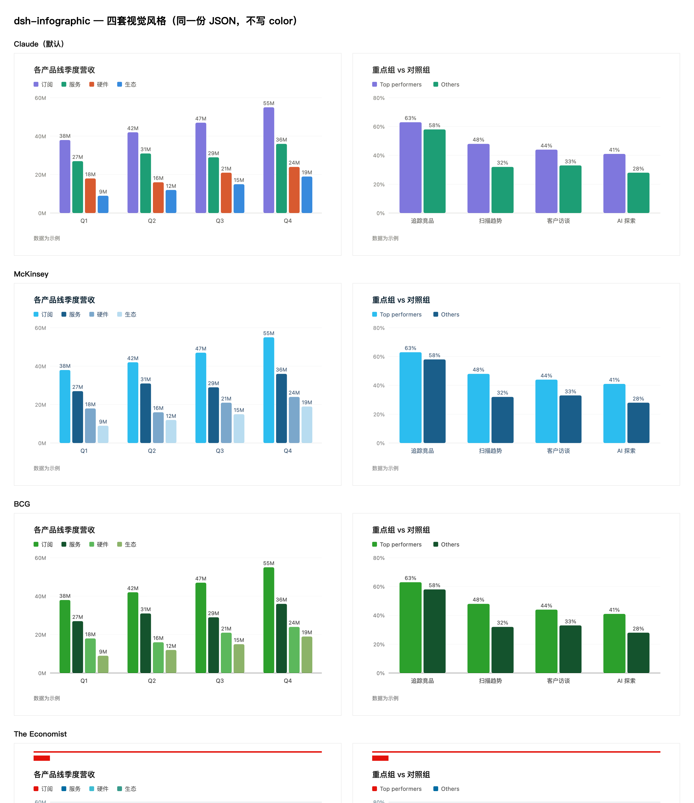

# DSH Claude-Style Infographics

让模型在 **DeepSeek Harness (DSH)** 对话里直接画出 **Claude Artifact 风格** 的专业图表、架构图和可视化信息图。

---

## 🌟 这是什么？

这是一个专为 DeepSeek Harness 设计的原生图表渲染插件。

- **行内无缝渲染**：模型在回答中输出 ` ```infographic ` 规范代码块（轻量纯 JSON，极低 token 开销），插件会在对话流中即时将其渲染成高清晰度的矢量 SVG。
- **Claude 原生美学**：沿用 Claude 官方 Artifact 的设计系统与 9 色调色板（无渐变、无杂乱阴影、极简 Flat 扁平化，字重视觉层级分明）。
- **四套商业视觉风格**：支持在 **Claude 原生（默认）**、**McKinsey（麦肯锡青蓝/极简高反差）**、**BCG（波士顿咨询经典单色绿）**、**The Economist（经济学人红版头与经典蓝红系列）** 之间自由切换。
- **一键导出分享**：图表底部自带交互工具栏，支持 **复制 PNG（直接粘贴至飞书、微信公众号后台、Word）**、**下载 PNG（高分高清）**、**复制/下载 SVG** 以及查看源码。
- **安全与流式体验**：纯静态沙箱渲染，模型边输出边流式绘制成形，写坏时自动安全回退，绝不丢失正文内容。

---

## 🎨 效果预览

### 1. 切换四套商业视觉风格

插件内置 4 套顶级咨询与财经媒体风格。**同一份图表数据，无需修改任何代码或字段，在图表右下角下拉菜单即可一键切换**：



- **Claude（默认）**：Claude 标志性 9 色体系（紫、青、珊瑚、蓝等），多系列色彩和谐柔和，适合通用场景。
- **McKinsey（麦肯锡）**：以亮青蓝 `#2CBDEF` 为重点组主色、浅灰 `#D4D4D4` 为对照组、深藏青 `#051C2C` 为文字基底。极简高反差，专为战略分析汇报打造。
- **BCG（波士顿咨询）**：以经典绿 `#2CA02C` 为唯一主色调，无杂色干扰，层次分明，呈现经典咨询报告风范。
- **The Economist（经济学人）**：复刻《经济学人》经典版头——顶部鲜红全宽横线 + 左上醒目红方块，数据系列由标志性红 `#E3120B` 与经典编辑蓝 `#006BA2` 领衔。

---

### 2. 支持的七种图表类型

| 图表类型 | 适用场景 | 示例预览 |
|---|---|---|
| **`flow` 流程图** | 业务逻辑、决策树、带分支/重试流程 |  |
| **`layers` 架构图** | 系统分层、模块解耦、技术栈全景 |  |
| **`bar` 柱状/条形图** | 业绩对比、榜单排行、堆叠/分组/水平条形 |  |
| **`line` 折线走势图** | 周期走势、多指标波动、面积填充图 |  |
| **`donut` 环形占比图** | 市场份额、成本构成、带中心数值标签 |  |
| **`cards` KPI 指标卡** | 核心数据大屏概览、带环比/同比趋势升降标签 |  |
| **`timeline` 时间轴** | 发展历程、迭代路线图、大事件里程碑 |  |

---

## 🚀 使用方式

无需繁琐的手动配置和终端敲命令，DSH 用户只需简单两步：

### 第一步：把链接发给 DSH 自动安装

在 DeepSeek Harness 对话框里把这个仓库链接发给 AI：

> **"帮我安装一下这个插件仓库：https://github.com/huangzhenhao90/dsh-claude-style-infographics"**

DSH 会自动拉取仓库、安装依赖并配置好运行环境。  
*(安装完成后，按照客户端提示重启一次 DSH 桌面端即可生效)*

### 第二步：如何激活与唤起画图

重启后即可直接使用！您不需要记住任何复杂的代码或 JSON 语法，支持两种激活方式：

1. **AI 智能主动激活（自动触发）**  
   插件已内置常驻系统提示与触发规则。日常对话中，当遇到业务流程梳理、系统架构设计、数据量化对比、周期走势分析或份额占比等场景时，**AI 只要判断「画图比纯文字更直观高效」，就会主动为您生成信息图**，无需刻意提示。

2. **指令明确唤起（手动指定）**  
   如果您当次明确希望得到可视化的信息图，只需在日常提问中带上 **“画图”** 或 **“画信息图”** 即可。例如：
   - *"画一个用户登录验证与鉴权的流程图"*
   - *"对比今年 4 个季度的各产品线营收，画信息图"*
   - *"做一张微服务架构分层图，画图展示接入层、逻辑层和数据层"*
   - *"画信息图展示一下产品发布的里程碑时间线"*
   - *"画一个市场份额占比图，用麦肯锡风格"*

图表在对话中实时生成后，点击图表底部的 **「复制 PNG」**，即可直接粘贴到飞书文档、微信公众号后台或 PPT 中！

---

## ⚙️ 设置选项与偏好控制

插件提供了完整的**画图频率控制**与**全局默认视觉风格**配置，满足不同用户习惯：

### 1. 三档画图频率策略
| 频率档位 | 策略行为 | 适用场景 |
|---|---|---|
| **🔥 积极（高）** | **视觉优先**。遇到流程、分层架构、数据对比、时间线或份额等场景，优先画图，用图表主导回答 | 汇报复盘、PPT 制作、喜欢高密度视觉输出 |
| **⚖️ 平衡（中，默认）** | **克制平衡**。当且仅当图表比纯文字明显更直观高效时才绘制；简单要点用文字交代 | 日常通用对话，保持阅读体验舒适平衡 |
| **🤫 克制（低）** | **文字优先**。严格保持纯文字交流，**绝不主动画图**；仅在被明确要求时才绘制 | 代码排错、长文写作，避免非必要视觉打扰 |

### 2. 全局默认风格
支持将 **Claude（默认）**、**McKinsey（麦肯锡）**、**BCG（波士顿咨询）**、**The Economist（经济学人）** 中的任意一套设为全局默认风格。

### 3. 设置入口与调节方式
- **全局设置入口（推荐）**：  
  点击 DSH 客户端左下角的 **「⚙️ 设置」**，在左侧导航菜单中点击 **「信息图设置」**，即可在主面板中直观切换画图频率档位与默认风格，自动全端同步与持久化。
- **对话吩咐（即时生效，无需重启）**：  
  插件内置了配置工具，在对话中直接告诉 AI 也能生效：
  - *"把画图频率改成高"* / *"画图频率设为克制模式"*
  - *"默认风格换成麦肯锡"*
  - *"查看当前信息图设置"*
- **单图快捷切风格**：  
  每张信息图底部的工具栏右侧保留了**风格下拉选择菜单**，方便在查看单张图时就地临时切换其他商业风格。

---

## 💡 创意来源

本项目的设计系统和视觉规范汲取自以下开源探索：

1. **[pi-generative-ui](https://github.com/Michaelliv/pi-generative-ui)** by [@Michaelliv](https://github.com/Michaelliv)：对 Claude 官方生成式 UI 系统的逆向工程与开源还原。
2. **真实商业咨询图表规范**：三套品牌风格（McKinsey、BCG、The Economist）的调色板与版式细节，精细对齐自麦肯锡官方研究报告、《经济学人》图表以及专业投研标准。

---

## 📄 License

MIT License
