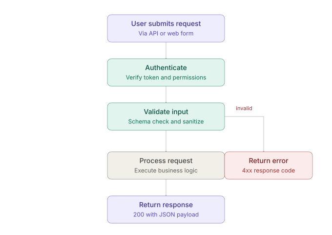
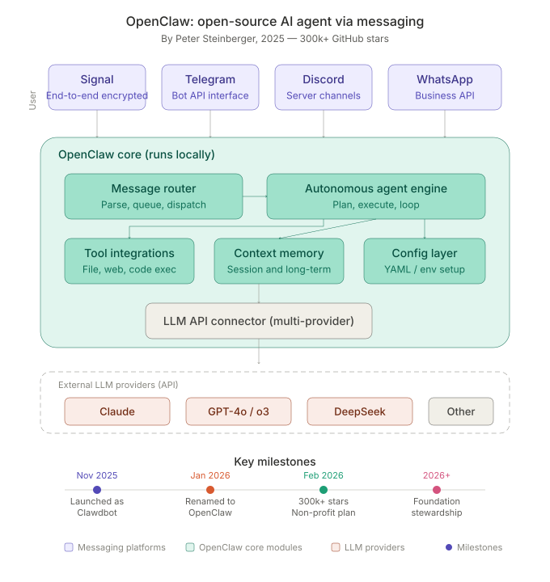
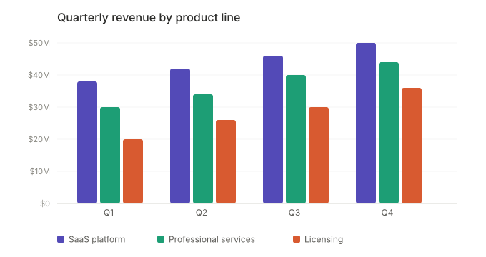
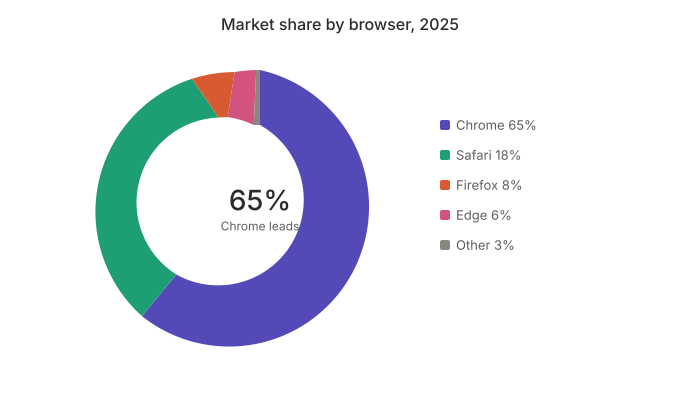

# Claude infographic Charts

一个 DSH 插件：让模型在 DeepSeek Harness（DSH）对话里直接画出 Claude artifact 风格的专业图表、流程图和可视化。

- **模型输出**：一小段 `infographic` JSON 规格（不是整段 SVG / HTML 文件）
- **渲染位置**：直接画在 DSH 对话里，边写边画
- **安全**：不执行模型写的任何标记，只画白名单里的七种图
- **导出**：复制 / 下载 PNG，复制 / 下载 SVG
- **适合**：对话里随手出图、改图；报告、PPT、公众号里的精修图

视觉规范沿用 Claude artifact 的那一套：9 色调色板、680px 画布、扁平风格、亮暗模式。另有 `mckinsey` / `bcg` / `economist` 三套品牌风格，一键切换（见[四套视觉风格](#四套视觉风格)）。

---

## DSH 嵌入模式

让模型在回答里写一段 ` ```infographic ` 围栏（内容是 JSON），DSH 对话界面把它当场画成 SVG 信息图，文字照常排在前后。


七种图：`flow` 流程图 · `bar` 柱状图 · `line` 趋势线 · `donut` 占比 · `cards` 指标卡 · `timeline` 时间线 · `layers` 分层架构。全部示例在 [`docs/gallery/`](docs/gallery/)，对应规格在 [`examples/`](examples/)；每张图都有亮、暗两版（`*.light.svg` / `*.dark.svg`），默认版跟随系统。

### 它怎么工作

- **节点侧**（`src/index.ts`）：往系统提示词里加一小段围栏语法说明，并注册内置 Skill `infographic`（完整字段表和示例在 [`dsh/SKILL.md`](dsh/SKILL.md)）。
- **浏览器侧**（`src/client/`）：观察对话 DOM，找到 `infographic` 围栏，隐藏宿主的代码块，在原位挂一个由本插件拥有的容器，里面是渲染出来的 SVG 和工具栏。
- **渲染核心**（`src/core/`）：纯 TypeScript、无 DOM 依赖。`JSON → 校验补全 → SVG 字符串`；所有文字都转义，颜色只能取调色板里的名字，每张 SVG 的样式都带唯一前缀，同一页放多张也不会互相影响。
- **流式**：围栏还在输出时，用宽容解析器取"目前已完整的部分"重画，截断的最后一个 token 直接丢弃；写完后补上工具栏。
- **失败可见**：围栏最终写坏了（不是 JSON、缺必填内容），保留宿主原来的代码块，并在上方给出一行原因，不会静默消失。

### 安装

```bash
pnpm install
pnpm build
dsh plugin --profile web add link:/绝对路径/claude-infographic-charts
```

包名、节点侧导出的 `name`、`cordis.patch.yml` 三处保持一致（`@huangzhenhao90/dsh-infographic`）；包目前标记为 `private`，发布到 npm 前请先确认 scope。安装方式沿用 [dsh-genui](https://github.com/omdsh-dev/dsh-genui) 的 `dsh plugin add` 约定。

### 60 秒验证

装好、重启 DSH 后，对模型说："用 infographic 画一个用户登录的流程图，要有失败重试。" 应当看到：围栏变成流程图；输出过程中图会逐步成形；写完后图下方出现 `复制 PNG / 下载 PNG / 复制 SVG / 下载 SVG / 源码`，右侧还有风格切换器。

### 规格速查

第一个键必须是 `"infographic"`。公共字段 `title` / `subtitle` / `note`。

| 类型 | 主要字段 |
|---|---|
| `flow` | `nodes[{id,label,sub?,shape?,color?}]`、`edges[["from","to","label?"]]`、`direction: down\|right` |
| `bar` | `categories[]`、`series[{name,data[],color?}]`、`horizontal?`、`stacked?`、`unit?` |
| `line` | 同 `bar`，另有 `area?` |
| `donut` | `data[{label,value}]`、`center?{value,label}` |
| `cards` | `items[{label,value,delta?,note?}]` |
| `timeline` | `items[{time?,title,desc?}]` |
| `layers` | `layers[{label,items[{label,sub?}]}]`、`arrows?` |

颜色只能写调色名：`purple teal coral pink gray blue green amber red`。各类型的数量上限、简写和选型建议见 [`dsh/SKILL.md`](dsh/SKILL.md)。

### 导出

- **复制 PNG**：直接进剪贴板，粘到飞书文档、Word、公众号编辑器里就是图（**推荐**——多数编辑器不认 SVG，粘 SVG 会变成一段代码）；
- **下载 PNG**：2 倍分辨率，白底（暗色页面为深色底），可插入 PPT 和公众号；
- **复制 SVG / 下载 SVG**：独立 SVG 文件，按当前页面的亮暗主题烘焙成单一主题，适合放进报告、网页、再做二次编辑；
- **PPT 原生对象导出尚未实现**，目前是把 PNG / SVG 作为图片插入。

### 非 DSH 页面

`lib/infographic.global.js` 是一个普通 `<script>` 构建，暴露 `window.DshInfographic`：

```html
<script src="infographic.global.js"></script>
<script>
  DshInfographic.installFenceChannel()                  // 把页面里的 infographic 代码块换成图
  const svg = DshInfographic.renderInfographic({ infographic: 'donut', data: [{ label: 'A', value: 3 }, { label: 'B', value: 1 }] })
</script>
```

只要代码块是 `<pre>`，且带 `infographic` 语言标签或内容以 `{"infographic":` 开头即可。纯渲染核心也可以单独使用：`import { renderInfographic } from '@huangzhenhao90/dsh-infographic/core'`。

### 开发

```bash
pnpm test        # 单元测试：宽容 JSON、规格校验、渲染、围栏读取、DOM 通道（jsdom）、节点插件
pnpm examples    # 重新生成 docs/gallery/ 里的 SVG
pnpm build       # tsc 类型声明 + tsdown 四个产物
pnpm check       # 清理 → 类型检查 → 测试 → 构建 → 产物协议检查 → 示例校验
```

`tests/browser/host.html` 是一个模拟 DSH 代码块结构的页面（含流式、写坏的围栏、整条消息容器、其他语言代码块），可以用任意 Chromium 打开 `lib/infographic.global.js` 做手动验证。

### 验证状态与尚未做的

- 已做：单元测试；在无头 Chrome 里用模拟 DSH 结构的页面跑通渲染、流式、暗色、被宿主清掉后的自动修复、PNG 导出。
- **尚未在真实 DSH 宿主里端到端验证**（插件加载、系统提示词注入、模型实际写出围栏）。宿主的 DOM 结构按 dsh-genui 的做法适配，若宿主版本变化导致发现失败，围栏会保持原样显示为代码块，不会丢内容。
- 暂未实现：围栏写坏时让模型自动重发的反馈回路、`validate` / `render` 模型工具、点击图元回传给模型的交互、PPT 原生导出。

---

## 效果预览

### 1) Flowchart 示例（优先看这个）



### 2) OpenClaw 架构概览



### 3) 分组柱状图



### 4) 甜甜圈图



> 交互式示例见 `tests/test-interactive-benchmark.html`

---

## 文件结构

```
claude infographic charts/
├── README.md                         ← 你正在读的这个
├── dsh/SKILL.md                      ← DSH 嵌入模式的内置 Skill（infographic 围栏规格）
├── src/ · examples/ · docs/gallery/  ← DSH 插件源码 / 规格示例 / 渲染结果
├── lib/                              ← pnpm build 的产物（不入库）
└── tests/
    ├── test-flowchart.svg            ← 测试流程图
    ├── openclaw-overview.svg         ← 架构概览图
    ├── test-bar-chart.svg            ← 柱状图示例
    ├── test-donut-chart.svg          ← 甜甜圈图示例
    └── test-interactive-benchmark.html ← 交互式 HTML 示例
```

---

## 设计系统核心

### 四套视觉风格

同一份 JSON，换风格不用改一个字段——`style` 只决定调色板与中性色：

| 风格 | 品牌锚点 | 自动配色顺序（不写 `color` 时） |
|------|---------|------------------------------|
| `claude`（默认） | Claude artifact 的柔和九色 | purple → teal → coral → blue → pink … |
| `mckinsey` | 亮青蓝 `#2CBDEF` + 对照灰 `#D4D4D4` + 深藏青 `#051C2C` | blue → teal → purple → pink → coral → gray |
| `bcg` | 标志性绿 `#2CA02C` | green → teal → blue → amber → purple → pink |
| `economist` | 红 `#E3120B` + 编辑蓝 `#006BA2` | red → blue → teal → green → amber → gray |

三套品牌风格的锚点取自真实的咨询 / 媒体图表规范，不是"把品牌色当主色调"了事：

- **McKinsey** 的语言是**极简高反差**——重点组用亮青蓝、对照组用浅灰，两色贯穿全报告。所以自动配色走的是同一个蓝的深浅，而不是九个色相。
- **BCG** 的语言是**绿色为唯一主色**，无渐变、无装饰。
- **The Economist** 的招牌是**版头**——顶部全宽红横线 + 左上红方块 tag。这两笔是版式元素，插件会为 `economist` 风格自动画出来（其它三套不画）；系列色则从红 `#E3120B` 起，接编辑蓝 `#006BA2` → 青 `#3EBCD2` → 绿 `#379A8B` → 黄 `#EBB434` → 灰 `#758D99`。

`claude` 的九个色系是**彼此分开的色相**（色相就是类别编码）。三套品牌风格正好相反——它们是**近单色**的：自动配色只在品牌自己的色相家族里走深浅，因为真实的麦肯锡 / BCG 图表本来就只有「一个品牌色 + 一个中性色」。

**所以调色名是一个「槽位」，不是色相承诺**：`blue` 在 `claude` 下是青蓝，在 `bcg` 下是一个深绿——因为 BCG 的视觉语言里根本没有蓝色。只有品牌风格的自动配色序列会这样重涂；`red` / `green` / `amber` 在四套风格里始终是红 / 绿 / 琥珀，所以涨跌色与告警色永远不会说谎。

### 9 色调色板（`claude`）

| 色系   | 400（主色）| 600（描边）| 800（深色）|
|--------|-----------|-----------|-----------|
| purple | `#7F77DD` | `#534AB7` | `#3C3489` |
| teal   | `#1D9E75` | `#0F6E56` | `#085041` |
| coral  | `#D85A30` | `#993C1D` | `#712B13` |
| pink   | `#D4537E` | `#993556` | `#72243E` |
| gray   | `#888780` | `#5F5E5A` | `#444441` |
| blue   | `#378ADD` | `#185FA5` | `#0C447C` |
| green  | `#639922` | `#3B6D11` | `#27500A` |
| amber  | `#BA7517` | `#854F0B` | `#633806` |
| red    | `#E24B4A` | `#A32D2D` | `#791F1F` |

每个色系包含 7 个色阶（50 / 100 / 200 / 400 / 600 / 800 / 900），完整色表见 `src/core/palettes.ts`。

### 两条核心规则

1. **ViewBox 宽度固定 680px** — 所有 SVG 使用 `viewBox="0 0 680 H"`，`width="100%"`
2. **Flat 美学** — 无渐变、无阴影、无模糊，字重只用 400 / 500

---

## 创意来源

本项目的设计系统和视觉规范提炼自：

**[pi-generative-ui](https://github.com/Michaelliv/pi-generative-ui)** by [@Michaelliv](https://github.com/Michaelliv)

该仓库对 Claude 内置的生成式 UI 系统进行了逆向工程和开源还原，包含完整的 SVG 样式定义（`svg-styles.ts`）、9 色调色板规范、以及 5 个视觉模块的 Claude 官方提示词指南（`diagram.md`、`interactive.md`、`art.md` 等）。

本插件的工作是：把上述规范从 Claude 的专有渲染上下文中抽离，落成可独立使用的数据与渲染规则（`src/core/theme.ts`、`src/core/palettes.ts`）。

---

## License

MIT
